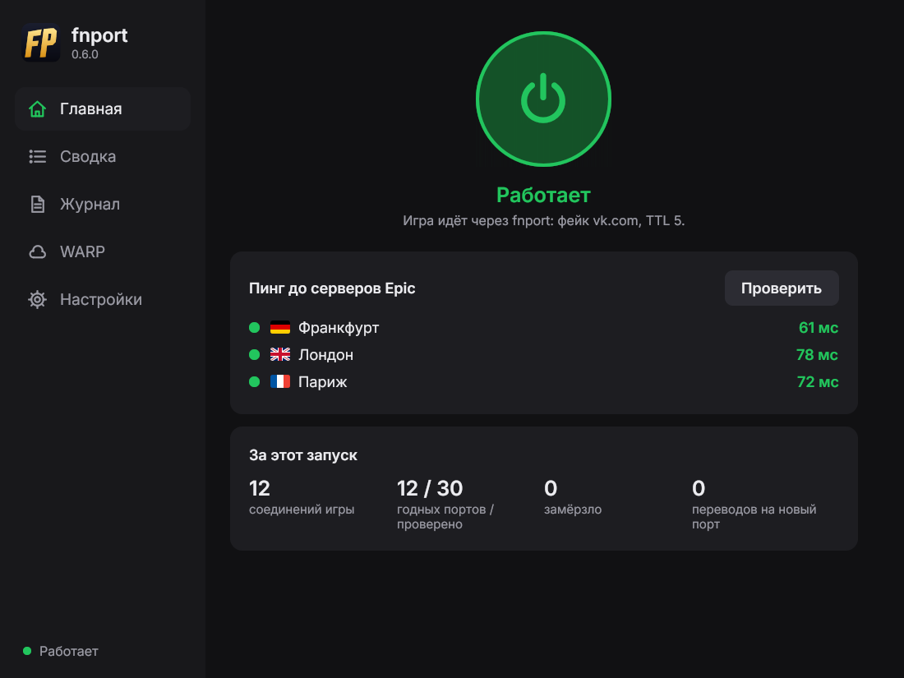

# fnport

Пакет для роутеров на **OpenWrt** и программа для **Windows**, которые помогают подключаться к серверам
**Fortnite** (AWS, Европа), когда провайдер «замораживает» игровой трафик. Симптомы: ошибка №5 при подборе, вечная загрузка
на 100%, вылет в лобби с «соединение разорвано».

- **Игра без VPN.** Игра ходит на сервер напрямую, с родным пингом.
- **Без запрета и WinDivert.** С роутером на ПК ничего ставить не нужно. Программа для Windows работает
  через сетевой адаптер Wintun, как WireGuard, и в игру не лезет.
- **Отключаемый обход.** Перехват игрового UDP на роутере зависит от обновляемого службой набора правил с тайм-аутом 5 секунд.
  Где заморозки нет, fnport сам уходит в ожидание и ничего не трогает.
- **Сам подстраивается.** «Проверка провайдера» выясняет, есть ли заморозка, и подбирает
  настройки; если фейк перестал работать, fnport берёт запасной.

> Проверено у двух провайдеров. Региональный провайдер с заморозкой (PPPoE, выход в Европу через
> Франкфурт): «Королевская битва», Blitz и «Сражение с Бурей» загружаются с первой попытки.
> Домашний интернет МТС: заморозки нет, fnport выключает фейк и не мешает. ТСПУ у разных провайдеров
> и в разное время ведёт себя по-разному, поэтому результат не гарантирован.

**Быстрый старт с роутером на OpenWrt:** [установите](#установка-на-роутер) пакет, в LuCI откройте **Службы → fnport**,
добавьте игровой ПК в «Устройства», отметьте «Включить», затем на вкладке «Проверка провайдера» нажмите
«Проверить провайдера» и, если предложит, «Применить TTL». Всё, можно играть.

**Без роутера на OpenWrt:** [программа для Windows](#fnport-для-windows). Скачайте архив из релиза, запустите
`fnport.exe`, в настройках нажмите «Проверить» в разделе «Проверка провайдера», затем включите круглую кнопку
на главной.

<p align="center"></p>

## Есть ли вирусы?

Краткий ответ: **НЕТ.**

- **Открытый код.** Всё, что делает fnport, лежит в этом репозитории. Файлы релизов собирает не автор на своём
  компьютере, а GitHub Actions из исходников ([workflow](.github/workflows/build.yml)).
- **Подтверждение сборки.** Начиная с версии 0.6.3 к каждому релизу GitHub прикладывает подписанную запись о том, из какого коммита
  и где собран каждый файл, включая `fnport.exe`. Проверить можно любой файл:
  `gh attestation verify fnport.exe -R YUNGSLXRD/fnport`. Контрольные суммы всех файлов — в `SHA256SUMS.txt`
  в релизе.
- **`wintun.dll`** — официальный драйвер сетевого адаптера от WireGuard, без изменений, с их подписью.
- **Почему Windows пишет «Система Windows защитила ваш компьютер».** У программы нет платной подписи
  разработчика, поэтому SmartScreen её не знает. Это предупреждение о неизвестном издателе, а не о вирусе.
- Программа не лезет в игру и в память других процессов, не ставит драйверов кроме адаптера Wintun
  и не собирает данных: отчёт для issue вы копируете сами, адресов вашей сети в нём нет.

## Что происходит

ТСПУ у многих провайдеров пропускает первые **25 пакетов** UDP-соединения с серверами AWS,
а дальше молча его глушит: без ошибки, просто перестают приходить ответы.

У этой заморозки есть две особенности, которыми пользуется fnport:

1. **Режут не все соединения.** Трафик раскидывается между несколькими узлами ТСПУ,
   и на какой узел попадёт соединение, зависит от **исходящего порта**. Одни узлы режут,
   другие нет. Поэтому без обхода в катку попадаешь «через раз».
2. **Есть белый список.** ТСПУ не трогает соединения, в которых увидел домен российского
   сервиса из своего «белого списка» (например, vk.com). Это исключение нужно, чтобы
   не ломать сами эти сервисы.

На пальцах: к серверу ведут несколько дорог со шлагбаумами. Одни шлагбаумы пропускают 25 машин
и закрываются, другие открыты. fnport перед поездкой показывает каждому шлагбауму «пропуск»,
проверяет, на какой дороге проезд свободен, и отправляет игру по ней.

## Как работает fnport

1. **Придерживает первый пакет.** ПК начинает подключаться к игровому серверу
   (UDP 9000–9999 и 15000–15999). Роутер придерживает первый пакет, игра через секунду его повторит.
2. **Показывает ТСПУ «пропуск».** С каждого проверяемого исходящего порта роутер шлёт один
   фейковый пакет QUIC с именем vk.com. У фейка маленький TTL (3 хопа): он проходит ТСПУ
   и пропадает по дороге, до сервера Epic не доходит. Если vk.com перестанет работать,
   fnport возьмёт запасной фейк (gosuslugi.ru, затем ozon.ru).
3. **Проверяет порт.** С того же порта роутер шлёт на игровой порт сервера 30 пакетов начала
   рукопожатия Unreal Engine. Сервер отвечает на них, не создавая сессию. Пришли все ответы,
   значит, путь открыт. Ровно 25 и тишина, значит, заморожен. За раунд проверяются 2 порта.
4. **Отдаёт игре проверенный порт.** Соединение игры уходит через NAT ровно с того порта,
   где прошла проверка. Для ТСПУ это то же самое, уже разрешённое соединение.
5. **Ищет дальше, если не повезло.** Если не прошёл ни один порт, проверяются ещё раунды,
   до 8 (16 портов). Если сервер перестал отвечать на проверки (бывает при входе в задание
   «Сражения с Бурей»), fnport один раз повторяет проверку, а затем выдаёт порт без проверки, но с фейком.
6. **Спасает замёрзшее соединение.** Если соединение всё-таки замёрзло, через 2–4 секунды
   роутер переводит его на новый порт с новым фейком (до 4 попыток). Игра продолжает
   слать с того же сокета, сервер видит только смену порта клиента.

Ещё fnport проверяет порт матча заранее: служебному порту 15062 соответствует порт матча 9062,
поэтому, увидев первый, он сразу проверяет второй. Пока игра до него дойдёт, порт уже готов.

И следит, чтобы не навредить:
- **где заморозки нет**, он это замечает (порты проходят и без фейка) и переходит в ожидание:
  соединения идут как есть, пока какое-нибудь не замёрзнет ([подробнее](#режим-ожидания));
- **где фейк сам ломает соединения** (у некоторых провайдеров ТСПУ убивает соединение, в котором
  увидел QUIC), он выключает фейк на 30 минут. Для этого нужно, чтобы без фейка порт **прошёл**:
  заморозка без фейка, наоборот, значит, что фейк нужен.

Цена: подключение к матчу на несколько секунд дольше (раунд проверки около 1,3 с).
Обычно уходит 1–3 раунда на соединение, во время игры задержки нет.

### Чем это отличается от zapret

Идея фейка с маленьким TTL взята из [zapret](https://github.com/bol-van/zapret), оттуда же сам файл фейка
(см. [THIRD_PARTY_NOTICES.md](THIRD_PARTY_NOTICES.md)). Остальное устроено иначе:

| | zapret на ПК (Flowseal, ALT11) | fnport на роутере | fnport для Windows |
|---|---|---|---|
| Где работает | ПК, драйвер WinDivert перехватывает пакеты | роутер, NAT | ПК, сетевой адаптер Wintun |
| Что видит античит | WinDivert, Easy Anti-Cheat его выгружает | ничего, на ПК пусто | ещё один сетевой адаптер, как у WireGuard |
| Фейков на соединение | 10–12, доходят до сервера | 1, до сервера не доходит | 1, до сервера не доходит |
| Содержимое фейка | мусор или чужой протокол | QUIC с доменом из белого списка | QUIC с доменом из белого списка |
| Проверка результата | нет | порт проверяется до того, как его получит игра | так же |
| Если не сработало | соединение умерло | новые порты, перевод соединения на новый порт | так же |

Фейки zapret доходят до сервера, и ТСПУ считает их в те же 25 пакетов. Поэтому против этой
заморозки zapret почти не помогает.

## Требования для роутера

- OpenWrt **24.10** или **25.12** (nftables, fw4). Только IPv4.
- Пакеты `ucode`, `ucode-mod-socket`, `ucode-mod-uci`, `ucode-mod-fs`, `ucode-mod-math`,
  `conntrack`, `nftables`, `kmod-nft-nat`. Менеджер пакетов поставит их сам.
- Игровой ПК подключён к этому роутеру, и роутер с fnport — **последний NAT** перед провайдером.
  Если за ним стоит ещё один роутер, это не мешает, а вот если **после** него есть ещё NAT,
  который меняет порты, выбор порта теряется.

## fnport для Windows

Если роутера с OpenWrt нет (Keenetic, роутер провайдера и любой другой), fnport можно запустить прямо на игровом
ПК с Windows 10 или 11 (64-бит). Свой роутер остаётся как есть.

1. Скачайте из [релиза](../../releases/latest) `fnport-windows-….zip` и распакуйте в обычную папку, например
   в «Документы». Запускать прямо из архива не нужно: рядом с программой лежат её настройки, журнал и папка `fakes`.
2. Запустите `fnport.exe` и разрешите права администратора: они нужны, чтобы создать сетевой адаптер.
   Программа не подписана, поэтому Windows может показать «Система Windows защитила ваш компьютер»:
   нажмите «Подробнее» → «Выполнить в любом случае».
3. Откройте **Настройки** и в разделе «Проверка провайдера» нажмите **«Проверить»** (1–3 минуты). Она выяснит,
   сохраняет ли роутер исходящий порт, есть ли заморозка и какие фейк и TTL подходят. Если предложит, нажмите «Применить».
4. На **Главной** нажмите круглую кнопку. Всё, можно играть. Крестик убирает программу в трей.

Как это устроено. Windows направляет трафик к AWS в Европе в виртуальный адаптер Wintun (тот же, что
у WireGuard). Программа отправляет игровые соединения дальше со своего порта, проверенного так же, как
на роутере, с фейком перед первым пакетом, а замёрзшие переводит на новый порт. В игру она не внедряется,
пакеты не перехватывает, драйвера вроде WinDivert нет. Остальной трафик к этим сетям, включая TCP, идёт
через адаптер без изменений. При выключении Windows удаляет адаптер вместе с маршрутами.

В окне: пинг до маяков Epic, сводка по городам и серверам (с какого порта игры на какой порт fnport
пересылает соединение, что замёрзло и спасено), журнал и настройки (адаптер, фейк и TTL, сети и порты,
параметры проверок, тёмная и светлая темы). Подробности — в [windows/README.md](windows/README.md).

> Проверено неделю игр у провайдера с заморозкой, fnport на роутере при этом был выключен. Заморозки
> случались, программа снимала их переводом на новый порт.

**Подключения для сервисов Epic и Discord.** На вкладке «Подключения» выберите WARP
или свой VPN, импортируйте конфигурацию и отметьте нужные сервисы. Для WARP ключ можно
получить в программе, для AmneziaWG поддерживается .conf, для VLESS ссылка или подписка.
Нажмите «Применить» и дождитесь подключения. Игровой UDP остается прямым.
Настройка Windows и OpenWrt: **[docs/connections.md](docs/connections.md)**.

Учтите:
- подбирать порты программа может, только если роутер **сохраняет исходящий порт**. Если порт меняется, программа
  всё равно работает, когда заморозку снимает фейк. «Проверка провайдера» проверяет и то и другое и скажет,
  нужен ли fnport на устройстве с OpenWrt;
- она помогает только ПК, на котором запущена. Консолям и телефонам нужен fnport на роутере;
- внешний VPN, который перехватывает весь игровой трафик, мешает прямому игровому маршруту. Встроенное подключение для выбранных сервисов можно оставить включенным;
- если у вас уже стоит fnport на роутере, уберите ПК из его «Устройств» или включите в настройках программы
  «Только пропуск через адаптер».

Отчёт о провайдере программа тоже делает: кнопка «Скопировать отчёт» под проверкой, серверы в нём показаны
городами, остальные адреса скрыты.

## Нет роутера с OpenWrt, а программа не подходит?

Тогда нужно устройство с OpenWrt, через которое ПК выходит в интернет: свой роутер, прошитый в OpenWrt,
второй роутер или виртуальная машина на игровом ПК. Пошаговая инструкция с картинками:
**[docs/no-openwrt.md](docs/no-openwrt.md)**.

Есть **готовый образ диска** (`fnport-…-x86-64.vhd.zip`, последний — в [релизе 0.6.1](https://github.com/YUNGSLXRD/fnport/releases/tag/v0.6.1)): OpenWrt
с уже установленным fnport. Один файл подходит и для виртуальной машины на игровом ПК (VirtualBox, Hyper-V),
и для мини-ПК или старого компьютера (записать на флешку или SSD через Rufus). Новые версии образ больше
не получает: fnport в нём обновляется кнопкой «Обновить» в LuCI.

## Установка на роутер

### Из релиза

Скачайте из [релизов](../../releases) пакеты под свою версию OpenWrt:

| OpenWrt | Пакеты |
|---|---|
| 25.12 | `fnport-*.apk`, `luci-app-fnport-*.apk`, `luci-i18n-fnport-ru-*.apk` |
| 24.10 | `fnport_*.ipk`, `luci-app-fnport_*.ipk`, `luci-i18n-fnport-ru_*.ipk` |

Скопируйте их на роутер, например в `/tmp`, и установите:

```sh
# OpenWrt 25.12
apk add --allow-untrusted /tmp/fnport-*.apk /tmp/luci-app-fnport-*.apk /tmp/luci-i18n-fnport-ru-*.apk
# OpenWrt 24.10
opkg install /tmp/fnport_*.ipk /tmp/luci-app-fnport_*.ipk /tmp/luci-i18n-fnport-ru_*.ipk
```

### Установщиком (рекомендуется)

Установщик сам найдёт последний релиз и пакеты под вашу версию OpenWrt:

```sh
wget -O /tmp/fnport-install.sh https://raw.githubusercontent.com/YUNGSLXRD/fnport/main/install.sh && sh /tmp/fnport-install.sh
```

Команду нужно выполнить на роутере. С Windows 10/11 это можно сделать без сторонних программ:
откройте PowerShell, введите `ssh root@192.168.1.1` (адрес вашего роутера), затем пароль от LuCI
(при вводе он не отображается) и вставьте команду установщика правой кнопкой мыши.

### Через LuCI, без консоли

- **OpenWrt 24.10:** скачайте из [релиза](../../releases/latest) три файла `.ipk`, в LuCI откройте
  **Система → Программное обеспечение**, нажмите «Загрузить пакет…» и установите по очереди:
  `fnport`, затем `luci-app-fnport`, затем `luci-i18n-fnport-ru`.
- **OpenWrt 25.12:** так не получится. Пакеты fnport пока не подписаны, а страница «Программное
  обеспечение» ставит только подписанные (ошибка `UNTRUSTED signature`). Используйте установщик
  через `ssh`, как выше: это одна команда, и она же потом обновляет fnport.

## Обновление

**На роутере.** Когда выходит новая версия, на странице **Службы → fnport → Статус** появляется
«Вышла версия fnport …» и кнопка **«Обновить»**: она запускает тот же установщик прямо из LuCI, без консоли.
Можно и командой: та же команда установщика обновляет fnport до последнего релиза. Настройки сохраняются,
а если служба была включена, она перезапустится уже с новой версией. Если последняя версия уже стоит,
установщик так и скажет и ничего не тронет. Переустановить ту же версию: `sh /tmp/fnport-install.sh -f`.

**Программа для Windows** сама не обновляется. Закройте её (правый щелчок по значку в трее → «Выход»),
скачайте из [релиза](../../releases/latest) новый `fnport-windows-….zip` и распакуйте туда же, куда и в первый раз,
соглашаясь на замену файлов. Настройки (`fnport.json`) и ваши фейки в папке `fakes` останутся, фейки из
программы обновятся.

## Настройка на роутере

В LuCI: **Службы → fnport**:
1. на вкладке «Основные» добавьте игровой ПК в «Устройства». Лучше закрепите за ним постоянный IP в DHCP;
2. отметьте «Включить» и нажмите «Сохранить и применить».

Через консоль:

```sh
uci add_list fnport.main.device='192.168.1.100'
uci set fnport.main.enabled='1'
uci commit fnport
/etc/init.d/fnport enable
/etc/init.d/fnport restart
```

### Проверка провайдера

На вкладке **Службы → fnport → Проверка провайдера** кнопка «Проверить провайдера» за 20–60 секунд
выясняет, есть ли у вашего провайдера заморозка, и подбирает TTL фейка:
1. по 2 короткие серии пакетов без фейка на публичные маяки Epic во Франкфурте, Лондоне и Париже:
   замерзают ли они на 25 пакетах. Решение ТСПУ зависит от города, поэтому проверяются все три;
2. если заморозка есть, фейк с TTL 1, 2, 3… на замерзающий маяк, пока он не начнёт проходить.
   Рекомендуется найденный TTL плюс один хоп запаса. Если текущий TTL не меньше найденного,
   менять ничего не нужно.

Кнопка «Применить TTL» записывает рекомендацию в настройки и перезапускает fnport (идущий матч
это не затрагивает). Ниже на странице готовый **отчёт для issue**: результаты, версия, сводка журнала,
без адресов вашей сети. Отправьте его через [шаблон «Отчёт о провайдере»](../../issues/new?template=provider-report.yml),
так fnport можно настроить под разных провайдеров. Проверку не стоит запускать часто: она отправляет
10–25 серий по 30 пакетов, а за частые проверки ТСПУ может «наказать» адрес. Повторный запуск
возможен не раньше чем через 3 минуты.

Из консоли: `/usr/libexec/fnport-check start`, затем `/usr/libexec/fnport-check status`.

**Консоли и телефоны** (PlayStation, Xbox, Switch, Fortnite на телефоне по Wi-Fi) добавляются в «Устройства»
так же, по IP. Можно добавить несколько устройств: каждое соединение проверяется отдельно.
Fortnite на телефоне через роутер с fnport проверен: работает.

На ПК на время игры **выключите**:
- **запрет и другие обходы с фейковыми UDP-пакетами.** Их фейки доходят до сервера, съедают лимит в 25 пакетов и портят хороший порт;
- **VPN, в том числе WARP.** Иначе игровой трафик пойдёт мимо роутера или только частично через него.

### Параметры

Всё в `/etc/config/fnport` (секция `main`) или на вкладке «Дополнительно» в LuCI.

| Параметр | По умолчанию | Что делает |
|---|---|---|
| `enabled` | `0` | Включить службу |
| `wan_interface` | `wan` | Интерфейс к провайдеру (устройство определяется само, PPPoE тоже) |
| `device` | — | IP игровых устройств или подсеть (например, `192.168.56.0/24`, не шире /16), можно несколько |
| `port_range` | `9000-9999`, `15000-15999` | UDP-порты игровых серверов (Fortnite: матч и служебный) |
| `pair_from` / `pair_offset` | `15000-15999` / `-6000` | Заранее проверять порт матча по служебному (15062 → 9062). Пусто — выключено |
| `qos_port` | `22222` | Эхо-порт сервера, если он не отвечает на рукопожатия (только без фейка) |
| `probe_batch` | `2` | Портов за раунд проверки |
| `max_rounds` | `8` | Раундов на соединение |
| `probe_budget` | `24` | Не больше стольких проверяемых портов в минуту на все серверы. Частые проверки ТСПУ «наказывает» |
| `verdict_ttl` | `90` | Сколько секунд хранить результат проверки |
| `whitelist_fake` | `quic_initial_vk_com.bin`, `quic_initial_gosuslugi_ru.bin`, `quic_initial_ozon_ru.bin` (в `/usr/share/fnport/`) | Список файлов фейка с белым SNI: только из `/usr/share/fnport/` или `/etc/fnport/`, до 1500 байт. Используется первый, остальные — запасные. Пусто — фейк выключен |
| `fake_ttl` | `3` | TTL фейка в хопах от роутера (1–16) |
| `standby` | `1` | Режим ожидания там, где заморозки нет (см. ниже) |

Числовые параметры ограничены пределами (`probe_batch` 1–12, `max_rounds` 1–16, `probe_budget` 4–120,
`verdict_ttl` 10–900). Значение вне предела служба заменит значением по умолчанию.
Увеличивать `probe_batch`, `max_rounds` и `probe_budget` без нужды не стоит: из-за слишком частых
проверок ТСПУ может на время закрыть все пути, а Epic — перестать отвечать на рукопожатия.

### Режим ожидания

Если у провайдера заморозки нет (так у домашнего интернета МТС), проверять порты и слать фейк незачем,
а фейк там ещё и может убить соединение. Поэтому fnport время от времени, когда подряд проходит
много портов, проверяет два порта **без** фейка. Если и без него проходит 6 портов подряд, fnport
переходит в ожидание: соединения игры идут как есть, без проверок и фейка. Как только какое-то
соединение замёрзнет, ожидание выключается, а замёрзшее соединение переводится на новый порт.

### Запасные фейки

Если фейк перестал работать (из 16 проверок с ним прошло не больше одной), fnport берёт следующий файл
из списка `whitelist_fake`. В пакете кроме vk.com есть фейки с именами gosuslugi.ru и ozon.ru: тот же
ClientHello браузера, только с другим именем. На маршруте до Лондона они проходили так: vk.com 3 из 4,
gosuslugi.ru 5 из 8, ozon.ru 3 из 8, без фейка 0 из 2. Свой фейк с другим именем можно сделать
скриптом [`tools/make_quic_fake.py`](tools/make_quic_fake.py) и положить в `/etc/fnport/`.

### Память о сети

Что fnport узнал о сети (ожидание, фейк ломает соединения, какой фейк работает), он запоминает
для каждой сети отдельно: ключ — шлюз провайдера (или PPP-пир) и его MAC. После перезапуска или
переезда роутера в другую сеть и обратно не нужно учиться заново. Хранится в `/etc/fnport/memory.json`,
статистика — в `/etc/fnport/stats.json` (на флеш пишется раз в 6 часов и при остановке службы).
Оба файла переживают обновление прошивки.

## Совместимость с провайдерами

Сводка по локальным тестам и сообщениям пользователей на 6 ноября 2026 года.
Каждая строка относится к конкретному подключению, версии и обращению. Результат может отличаться
в другом городе, у другого абонента того же провайдера или после изменения фильтрации.
Дата в таблице относится к первому сообщению; наблюдения учитывают последующие ответы.
Если версия или город неизвестны, это указано явно.

| Провайдер, город | Версия fnport | Дата обращения / теста | Результат в игре | Наблюдения | Источник |
|---|---|---|---|---|---|
| МТС, домашний интернет, город не указан | не указана | октябрь 2026 | Данных об игре недостаточно | В локальной проверке заморозки не было; фейк обрывал ответы. Этот результат не относится ко всем сетям МТС. | Локальная проверка |
| МегаФон, раздача на ПК, город не указан | не указана | октябрь 2026 | Работает без fnport | Fortnite запускался через мобильный интернет без обхода. | Локальный тест |
| Т2, раздача на ПК, город не указан | не указана | октябрь 2026 | Работает без fnport | Fortnite запускался через мобильный интернет без обхода. | Локальный тест |
| Ростелеком, Краснодар, компьютерный клуб | не указана | октябрь 2026 | Помогает частично | Без fnport поиск матча иногда не удавался; после включения снова находил матчи. Проверялся TTL 5. | Личный тест автора |
| Дом.ру, Тюмень | 0.5.0, 0.6.0 | 24.10.2026 | Матчи запускались, остаются проблемы | Подходящий TTL менялся. Позже автор сообщил, что кик Forbidden tool повторялся и без fnport; причина не установлена. | [#3](https://github.com/YUNGSLXRD/fnport/issues/3) |
| SkyNet, Санкт-Петербург | 0.5.2 | 25.10.2026 | Матч запускался, остаются проблемы | В одном из запусков матч загрузился, но автор сообщил о сильных потерях пакетов; повторной проверки по кабелю нет. | [#4](https://github.com/YUNGSLXRD/fnport/issues/4) |
| Билайн, Москва, домашний интернет | 0.6.1 | 28.10.2026 | Данных недостаточно | Нет описания результата в игре. | [#7](https://github.com/YUNGSLXRD/fnport/issues/7) |
| МТС, Екатеринбург | 0.6.1 | 28.10.2026 | Данных недостаточно | Нет описания результата в игре. | [#9](https://github.com/YUNGSLXRD/fnport/issues/9) |
| Телплюс, Астрахань | 0.6.2 | 29.10.2026 | Не удалось подключиться | Ошибка №1. Проверка нашла меньший TTL, но в настройках остался TTL 5; результата после изменения нет. | [#12](https://github.com/YUNGSLXRD/fnport/issues/12) |
| ТелекомМПК, Талдом | 0.6.3 | 01.11.2026 | Матчи запускались, остаются проблемы | Потери и нестабильный пинг сохранились по ответу автора; успешные пробы с TTL 6 проблему не объясняют. | [#16](https://github.com/YUNGSLXRD/fnport/issues/16) |
| МегаФон, Ханты-Мансийск, тип подключения не уточнен | 0.6.3 | 01.11.2026 | Данных недостаточно | Маяки не ответили; попытка входа в матч в журнале отсутствует. | [#18](https://github.com/YUNGSLXRD/fnport/issues/18) |
| Севстар, Севастополь | 0.6.3 | 02.11.2026 | Данных недостаточно | Есть сообщение об ошибке №1 в частных режимах. В другом отчете ответы маяка с фейком сократились до 0 и 5 из 30; нового игрового журнала нет. | [#21](https://github.com/YUNGSLXRD/fnport/issues/21), [#42](https://github.com/YUNGSLXRD/fnport/issues/42) |
| Teleos, Братск | 0.6.3 | 02.11.2026 | Не удалось подключиться | Загрузка возвращает в меню. Проба проходит, но игровое соединение останавливается после двух ответов; причина не установлена. | [#22](https://github.com/YUNGSLXRD/fnport/issues/22) |
| Avanta Telekom, Краснодар | 0.6.3 | 02.11.2026 | Не удалось подключиться | В первом отчете ошибка №5, проверка HTTPS сервисов Epic не проходит; попытки игры с включенным fnport в журнале нет. | [#26](https://github.com/YUNGSLXRD/fnport/issues/26) |
| AirNet, Санкт-Петербург | 0.6.3 | 02.11.2026 | Не удалось подключиться | Долгое подключение и FailedToConnect; игровые пробы не проходят. Через мобильный интернет автор смог зайти в матч. | [#30](https://github.com/YUNGSLXRD/fnport/issues/30) |
| SkyNet, Санкт-Петербург | 0.6.3 | 02.11.2026 | Данных недостаточно | В #31 игровых соединений нет. В #40 есть проблемы доступа к сервисам Epic и проверки игрового порта; результат матча не описан. | [#31](https://github.com/YUNGSLXRD/fnport/issues/31), [#40](https://github.com/YUNGSLXRD/fnport/issues/40) |
| МТС, Краснодар | 0.6.3 | 02.11.2026 | Данных недостаточно | Игровые соединения останавливаются после 25 ответов при TTL 3; результата после переключения на запасной фейк нет. | [#33](https://github.com/YUNGSLXRD/fnport/issues/33) |
| Дом.ру, Тюмень | 0.6.3 | 03.11.2026 | Данных недостаточно | Программа не запустила обработку трафика: не найдена wintun.dll. Это не проверка совместимости сети. | [#34](https://github.com/YUNGSLXRD/fnport/issues/34), [#35](https://github.com/YUNGSLXRD/fnport/issues/35) |
| Тринити, Мариуполь | 0.6.3 | 03.11.2026 | Данных недостаточно | Сервисы Epic и маяки отвечают, WARP еще подключается; результат игры не описан. | [#37](https://github.com/YUNGSLXRD/fnport/issues/37) |
| ТТК, Иркутск | 0.6.3 | 03.11.2026 | Данных недостаточно | Сервисы Epic отвечают, маяки нет; игровых соединений в журнале нет. | [#38](https://github.com/YUNGSLXRD/fnport/issues/38) |
| Ростелеком, Сыктывкар | 0.6.3 | 03.11.2026 | Матчи запускались, остаются проблемы | Автор сообщает об ошибке №1 примерно в двух случаях из трех. При TTL 3 с фейком маяк отвечает хуже; остановки игры есть и после временного отключения фейка. | [#41](https://github.com/YUNGSLXRD/fnport/issues/41) |
| ТТК, Рязань | 0.6.3 | 04.11.2026 | Данных недостаточно | Сообщается об ошибке №1, но в журнале нет попытки матча с включенным fnport. | [#43](https://github.com/YUNGSLXRD/fnport/issues/43) |
| Комета, Шебекино | 0.6.3 | 04.11.2026 | Данных недостаточно | Ошибка определения DNS-адреса CDN. В последнем запуске WARP еще не подключился; результата матча нет. | [#45](https://github.com/YUNGSLXRD/fnport/issues/45) |
| Трак, Краснотурьинск | 0.6.3 | 04.11.2026 | Не удалось подключиться | Ошибка №1, игровые соединения останавливаются после 25 ответов. Результата после перехода на запасной фейк нет. | [#46](https://github.com/YUNGSLXRD/fnport/issues/46) |
| Аксиома, Красноярск | 0.6.3 | 04.11.2026 | Данных недостаточно | Проверка не смогла определить DNS-адрес сервиса входа Epic; результат игры не описан. | [#47](https://github.com/YUNGSLXRD/fnport/issues/47) |
| Avanta Telekom, Краснодар | 0.6.3 | 04.11.2026 | Матчи запускались, остаются проблемы | Автор сообщает об ошибке №5 и кике после входа. В исходном журнале соединения останавливаются после 25 ответов; причина кика не установлена. | [#48](https://github.com/YUNGSLXRD/fnport/issues/48) |
| AVIEL, Раменское | 0.6.3 | 04.11.2026 | Данных недостаточно | Программа не запустила обработку трафика: не найдена wintun.dll. Это не проверка совместимости сети. | [#49](https://github.com/YUNGSLXRD/fnport/issues/49) |
| ТМПК, Дубна | 0.6.3 | 04.11.2026 | Помогает частично | Сначала ошибка №1 и остановка после четырех ответов; позже автор сообщил о трех сыгранных матчах, но ошибки после матча остаются. | [#50](https://github.com/YUNGSLXRD/fnport/issues/50) |
| KUBAN-TELECOM, город не указан | 0.6.3 | 04.11.2026 | Данных недостаточно | Вход Epic в проверке открывается через WARP, напрямую нет; сам fnport выключен, результата матча нет. | [#51](https://github.com/YUNGSLXRD/fnport/issues/51) |
| Тетрон, Воскресенск | 0.6.3 | 05.11.2026 | Данных недостаточно | Сервисы Epic и маяки отвечают; игровых соединений в журнале нет. | [#52](https://github.com/YUNGSLXRD/fnport/issues/52) |
| Ростелеком, Боровичи, Новгородская область | не указана | 06.11.2026 | Данных недостаточно | Результат игры в обращении не описан. | [#53](https://github.com/YUNGSLXRD/fnport/issues/53) |
| Ростелеком, Красноярск | 0.6.3 | 06.11.2026 | Данных недостаточно | Сервисы Epic и маяки отвечают; игровых соединений в журнале нет. | [#54](https://github.com/YUNGSLXRD/fnport/issues/54) |
| Орион Телеком, Красноярск | 0.6.3 | 06.11.2026 | Не удалось подключиться | Автор сообщает, что матч не находится. Маяки не ответили; ни один из 30 проверенных игровых портов не прошел. | [#55](https://github.com/YUNGSLXRD/fnport/issues/55) |
| Донтелл, Новошахтинск | 0.6.3 | 06.11.2026 | Данных недостаточно | Проверка сообщает о заморозке, но игровых соединений и описания результата матча нет. | [#56](https://github.com/YUNGSLXRD/fnport/issues/56) |

Успешная проверка маяков Epic сама по себе не подтверждает вход в матч. Игровой сервер может
вести себя иначе. Если с fnport стало хуже, сравните одну попытку с полностью выключенной программой
и сохраните журнал обеих попыток. Не включайте фейк и не повышайте TTL только потому, что маяки ответили.
Значения TTL в отдельных отчетах описывают тот запуск и не служат готовой настройкой для всего провайдера.

На мобильном интернете NAT телефона или оператора может менять исходящий порт, а маяки Epic могут
ограничивать ответы на общий внешний адрес. Этих признаков недостаточно, чтобы определить результат игры:
сначала попробуйте зайти в матч без fnport.

Добавить свой результат можно через «Проверку провайдера» и
[шаблон «Отчет о провайдере»](../../issues/new?template=provider-report.yml).
Приложите отчет после попытки матча и напишите, удалось ли сыграть, есть ли вылеты и как игра работает
с полностью выключенным fnport.

## Журнал и статистика на роутере

```sh
logread -e fnport | tail -30
```

У программы для Windows то же самое на вкладках «Главная», «Сводка» и «Журнал», а журнал ещё и в файле
`fnport.log` рядом с программой.

На вкладке «Статус» в LuCI: подсказки, если что-то не так (на игровом устройстве включён VPN, фейк выключен,
много заморозок за последние часы), текущий режим (работает или ожидание, какой фейк, выключен ли он),
статистика по дням за неделю и по часам за последние сутки (соединения через проходящий порт,
пропущенные в ожидании, без порта, замёрзшие, переведённые на новый порт, доля прошедших проверок)
и последние события журнала.

| Сообщение | Что значит |
|---|---|
| `started: ... whitelist fake quic_initial_vk_com.bin, ttl 3 (2 spare)` | Служба запущена, фейк включён, 2 запасных |
| `probe IP:PORT via game port: 1 good, 1 frozen, 0 silent` | Раунд проверки: 1 порт открыт, 1 заморожен |
| `flow IP:PORT (pc:N) -> wan port M` | Соединение игры отправлено через проверенный порт M |
| `server IP:PORT does not answer probes, untested ports ...` | Сервер молчит, порты выданы без проверки |
| `frozen flow ... - port dropped` | Соединение всё-таки замёрзло, порт больше не выдаётся |
| `flow ... remapped -> wan port M (attempt N)` | Замёрзшее соединение переведено на новый порт |
| `flow ... -> no good port, passing as is` | За все раунды не нашлось открытого порта |
| `probe budget exhausted` | Достигнут лимит проверок в минуту, соединение пропущено без обработки |
| `server limits handshake replies` | Epic ограничил ответы на проверки для вашего адреса |
| `whitelist fake breaks flows on this network ... fake off for 30 min` | С фейком сервер молчит, а без него порт проходит: у вашего провайдера фейк убивает соединения, fnport выключил его на 30 минут |
| `control without the fake IP:PORT: 30, 30 replies` | Проверка двух портов без фейка: есть ли заморозка вообще |
| `no freeze on this network (...): standing by` | Заморозки нет, fnport перешёл в ожидание |
| `flow ... -> passing as is (standing by)` | В ожидании соединение пропущено как есть |
| `freeze seen (...): standby off` | Соединение замёрзло, ожидание выключено |
| `fake X does not work here (...), switching to Y` | Фейк перестал работать, взят следующий из списка |
| `this network was seen before: ...` | fnport вспомнил, что знает об этой сети |

## Если не работает

- **В журнале пусто во время подбора.** Пока идёт поиск игроков, fnport ничего не делает:
  он включается, только когда игре выдали сервер. Долгий поиск — это очередь Epic, а не fnport.
- **В журнале пусто, когда игра уже подключается.** Проверьте IP в «Устройствах» и выключите VPN/WARP на ПК.
- **Много `no good port` и `frozen flow`.** Возможно, у вашего провайдера фейк не работает:
  - запустите «Проверку провайдера» (см. выше): она покажет, помогает ли фейк и с каким TTL;
  - если не помогает, выключите фейк (пустой `whitelist_fake`). fnport будет работать как раньше,
    только перебором портов;
  - если ТСПУ режет все пути разом, не поможет ничего. Подождите: иногда это проходит через 10–30 минут.
- **В журнале `whitelist fake breaks flows`, а соединения потом замерзают.** Значит, вывод был ошибочным
  (в версиях до 0.4.1 так бывало, если сервер на секунду замолкал). Обновитесь установщиком и сбросьте
  память о сети: `rm /etc/fnport/memory.json && /etc/init.d/fnport restart`.
- **fnport в ожидании («Статус» → «Режим»), а соединения замерзают.** Первое же замёрзшее соединение
  выключает ожидание само. Если хочется, чтобы fnport работал всегда, снимите «Режим ожидания» на вкладке
  «Дополнительно» (`standby` = `0`).
- **Переехали с роутером к другому провайдеру.** Ничего делать не нужно: память хранится для каждой сети
  отдельно. Но TTL фейка у нового провайдера может быть другим: запустите «Проверку провайдера».
- **Стоит Podkop/Forkop или похожий обход с fakeip.** Серверы Fortnite приходят адресами, без DNS, поэтому fnport
  это не мешает. Но если в списках VPN есть `amazonaws.com`, другие игры на AWS GameLift страдают: у Apex,
  например, европейские дата-центры показывают пинг -1 и 100% потерь — их маяки `gamelift.*.amazonaws.com`
  уходят в VPN, а он UDP не пропускает. Уберите эти домены из VPN.
- **Выкидывает при загрузке, а в журнале нет `frozen flow`.** Скорее всего, сбой на стороне сервисов
  Epic или в HTTPS-соединениях игры: fnport их не трогает.

## Частые вопросы

- **Заметит ли античит?** С роутером на ПК ничего не ставится и не запускается, игра видит обычную сеть.
  Программа для Windows в игру не внедряется и пакеты не перехватывает: для игры это ещё один сетевой
  адаптер, как у WireGuard. Неделю игр с ней Easy Anti-Cheat ни на что не жаловался.
- **Вырастет ли пинг?** Игровой UDP идет напрямую, без промежуточного VPN-сервера.
  Подбор порта задерживает начало подключения на несколько секунд, при повторных пробах дольше.
  После выбора порта игровые пакеты пересылаются сразу; проверки не добавляют такую паузу к каждому пакету.
- **Это VPN?** Игровой обход fnport отправляет UDP напрямую на сервер игры.
  На вкладке «Подключения» можно отдельно направить сервисы Epic, Discord и выбранные приложения через WARP
  или свой VPN. Адаптер Windows передает трафик программе на том же ПК.
- **Нужен ли fnport для других игр?** Он настроен на порты Fortnite. У провайдера, где fnport проверялся,
  Dead by Daylight (AWS во Франкфурте) и Apex (AWS в США) шли без заморозки: ТСПУ там режет не весь AWS,
  а именно Fortnite. Если у вас другая игра на AWS замерзает так же, добавьте её UDP-порты в
  «Порты игровых серверов» (на роутере — `port_range`) и пришлите [отчёт](../../issues/new?template=provider-report.yml).
- **Сколько трафика тратят проверки?** Около 5 КБ на проверку порта, до сотни КБ на матч.
- **Дома ошибка 5, а fnport поставить негде?** Попробуйте раздать на ПК мобильный интернет с телефона: у МегаФона
  и Т2 заморозки Fortnite в октябре 2026 не было. Это временный выход: мобильный интернет бывает нестабилен
  и иногда работает только по белым спискам.
- **Можно ли без роутера с OpenWrt?** Да, [программой для Windows](#fnport-для-windows).
  При смене исходящего порта роутером программа тоже может помочь, если фейк с ПК снимает заморозку.
  Это проверяет «Проверка провайдера». Другие варианты: [docs/no-openwrt.md](docs/no-openwrt.md).

## Удаление

**Программа для Windows:** закройте её (правый щелчок по значку в трее → «Выход») и удалите папку.
Адаптер `fnport` и его маршруты Windows убирает сама, когда программа выключается. Для уведомлений программа
оставляет значок в `%LOCALAPPDATA%\fnport` и запись в реестре; убрать и их (командная строка):

```bat
rmdir /s /q "%LOCALAPPDATA%\fnport"
reg delete "HKCU\Software\Classes\AppUserModelId\YUNGSLXRD.fnport" /f
```

**На роутере:**

```sh
/etc/init.d/fnport stop
apk del luci-i18n-fnport-ru luci-app-fnport fnport     # или: opkg remove luci-i18n-fnport-ru luci-app-fnport fnport
rm -rf /etc/fnport /etc/config/fnport                   # статистика, память о сети и настройки, если они больше не нужны
```

## Изменения

См. [CHANGELOG.md](CHANGELOG.md).

## Лицензия

[MIT](LICENSE). Файл фейка `quic_initial_vk_com.bin` взят из zapret, запасные фейки сделаны из него;
все они распространяются по лицензии zapret (MIT), подробности в [THIRD_PARTY_NOTICES.md](THIRD_PARTY_NOTICES.md).
Там же — о `wintun.dll`, шрифте Inter и библиотеках в программе для Windows.
